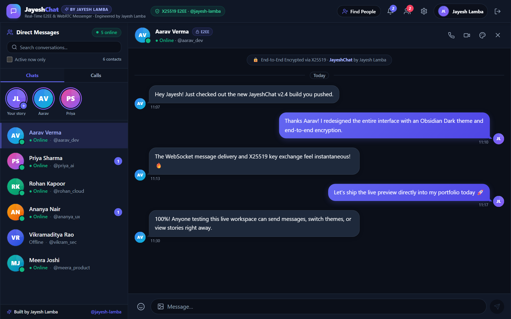

<div align="center">

# 💬 JayeshChat — Real-Time E2EE & WebRTC Messenger

**Architected & Engineered by [Jayesh Lamba](https://github.com/jayesh-lamba)**

[](https://jayesh-lamba.github.io/Real-Time-Chat-App/)
[](https://github.com/jayesh-lamba)
[](./LICENSE)

**JayeshChat** is a full-stack real-time communication platform built with **React 18, Node.js, Express, MongoDB, Socket.IO, WebRTC, and libsodium (X25519 + XSalsa20-Poly1305)**. It combines sub-20ms bidirectional messaging, client-side end-to-end encryption, peer-to-peer voice & video calling, 24-hour ephemeral stories, and a mutual connection graph inside a custom **Obsidian & Electric Indigo** dark interface.



</div>

---

## ✨ Core Engineering Highlights

- **🔒 Client-Side End-to-End Encryption (E2EE)**:
  - Asymmetric **X25519** keypair generation on the client via `libsodium-wrappers`.
  - Private keys remain strictly isolated in browser **IndexedDB** (`jayeshchat-keystore`) and never touch the server.
  - Messages are encrypted client-side with **XSalsa20-Poly1305** authenticated encryption before transit.
- **⚡ Real-Time Bidirectional Messaging (`Socket.IO`)**:
  - Instant message delivery, live typing indicators, read receipts, message editing, multi-select forwarding, and unsend-for-everyone.
  - Custom sticker engine and media attachments (images & video).
- **📹 Peer-to-Peer Voice & Video Calling (`WebRTC`)**:
  - Full SDP offer/answer handshake and ICE candidate trickle over Socket.IO signaling.
  - Minimizable floating PiP call window, camera/microphone mute toggles, and persistent call history logs.
- **📸 24-Hour Ephemeral Stories**:
  - Instagram-style story rings, full-screen auto-advancing story viewer, caption overlays, and real-time viewer tracking.
- **🤝 Mutual Connection Graph**:
  - Privacy-first messaging: search users by `@username`, send/accept/decline connection requests, and manage verified contacts.
- **🎨 Obsidian & Electric Indigo Studio UI**:
  - Designed by **Jayesh Lamba** with custom message bubble tails, per-chat wallpaper themes, and an instant **Interactive Live Workspace** mode so visitors can test the full application immediately.

---

## 🛠️ Tech Stack

| Layer | Technologies |
| :--- | :--- |
| **Frontend** | React 18, Vite, Zustand, Tailwind CSS, DaisyUI, Lucide Icons, React Router |
| **Cryptography** | `libsodium-wrappers` (X25519 Diffie-Hellman + XSalsa20-Poly1305), Web IndexedDB API |
| **Real-Time & Calling** | Socket.IO Client/Server, WebRTC (`RTCPeerConnection`, Google STUN) |
| **Backend** | Node.js, Express.js, MongoDB & Mongoose, JWT (`httpOnly` cookies), Cloudinary |

---

## 🚀 Quick Start (Local Development)

### 1. Clone the Repository

```bash
git clone https://github.com/jayesh-lamba/Real-Time-Chat-App.git
cd Real-Time-Chat-App
```

### 2. Configure Environment Variables

Create a `.env` file inside `backend/`:

```env
PORT=5001
MONGODB_URI=your_mongodb_connection_string
JWT_SECRET=your_jwt_secret_key
CLOUDINARY_CLOUD_NAME=your_cloudinary_cloud_name
CLOUDINARY_API_KEY=your_cloudinary_api_key
CLOUDINARY_API_SECRET=your_cloudinary_api_secret
NODE_ENV=development
```

### 3. Install Dependencies & Run

```bash
# Install backend & frontend dependencies and build
npm run build

# Start backend server (port 5001)
npm --prefix backend run dev

# Start frontend Vite server (port 5173)
npm --prefix frontend run dev
```

---

## 👨‍💻 Author

**Jayesh Lamba**
- GitHub: [@jayesh-lamba](https://github.com/jayesh-lamba)
- Portfolio: [Jayesh Lamba — Portfolio](https://jayesh-lamba.github.io/Portfolio/)
- Email: [jayeshanand160@gmail.com](mailto:jayeshanand160@gmail.com)

---

## 📄 License

Distributed under the **MIT License**. Copyright © 2026 **Jayesh Lamba**.
